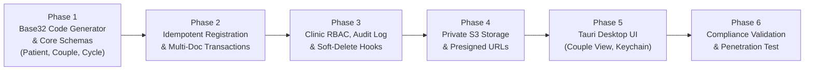

# Enterprise Clinical Architecture & User Data Plan — Pretheeksha Fertility Software

This document provides the complete, production-grade clinical specification for patient management, couple relationships, treatment cycles, security, compliance, and server implementation.

---

## 1. Patient Identification: Crockford Base32 with Check Character

### A. The Core Principle
The patient ID is **random, immutable, and decoupled from the phone number**. Phone numbers are treated as standard contact data (which can change, be shared, or have multiple entries).

### B. Crockford Base32 Identifier Specification
* **Alphabet**: `0123456789ABCDEFGHJKMNPQRSTVWXYZ` (32 characters).
  * Excludes confusing letters: `I`, `L`, `O`, `U` to prevent mistranscription on printed test tubes, lab slides, and bills.
* **Format**: 8 random Crockford Base32 characters + 1 Mod-37 check character (Total: 9 chars, e.g. **`7K2M9QXT4`**).
* **Entropy**: $32^8 \approx 1.1 \text{ trillion}$ unique combinations.
* **Collision Resolution**: Handled via MongoDB unique index on `{ code: 1 }` with up to 3 automatic retries on duplicate key error (`E11000`).
* **Typo Protection**: The check character immediately catches reception data-entry typos client-side before any network request or database write occurs.

### C. Generator Reference
```typescript
import { randomBytes } from "crypto";

const ALPHABET = "0123456789ABCDEFGHJKMNPQRSTVWXYZ";
const CHECK_ALPHABET = "0123456789ABCDEFGHJKMNPQRSTVWXYZ*~$=U"; // 37 symbols

function calculateCheckChar(body: string): string {
  let sum = 0;
  for (const c of body) {
    sum = (sum * 32 + ALPHABET.indexOf(c)) % 37;
  }
  return CHECK_ALPHABET[sum];
}

export function generatePatientCode(): string {
  const bytes = randomBytes(8);
  let body = "";
  for (let i = 0; i < 8; i++) {
    body += ALPHABET[bytes[i] % 32];
  }
  return body + calculateCheckChar(body); // e.g. "7K2M9QXT4"
}
```

---

## 2. Domain Data Model Architecture

The data model cleanly separates the individual person, the clinical partnership, the treatment cycle, clinical visits, and laboratory diagnostic records:

```
┌─────────────────┐           ┌─────────────────┐
│     Patient     │           │     Patient     │
│ (Intended Mom)  │           │  (Intended Dad) │
└────────┬────────┘           └────────┬────────┘
         │                             │
         └──────────────┬──────────────┘
                        │ members: [ { patient, role } ]
                        ▼
               ┌─────────────────┐
               │  Couple / Case  │
               └────────┬────────┘
                        │
                        ▼
               ┌─────────────────┐
               │ Treatment Cycle │ (IVF, IUI, ICSI, FET)
               └────────┬────────┘
                        │
           ┌────────────┴────────────┐
           ▼                         ▼
  ┌─────────────────┐       ┌─────────────────┐
  │ Clinical Visit  │       │   Lab Result    │
  │  & Scans (Enc)  │       │ (Semen, AMH,..) │
  └─────────────────┘       └─────────────────┘
```

---

### A. Patient Entity (`PatientSchema` in `user-preth`)
Represents an individual human being. Never hardcodes a spouse or treatment.
```typescript
const PatientSchema = new Schema({
  code: { type: String, unique: true, required: true, uppercase: true }, // e.g. "7K2M9QXT4"
  fullName: { type: String, required: true, trim: true },
  searchName: { type: String, required: true, lowercase: true, index: true }, // Normalized for prefix search
  dateOfBirth: { type: Date, required: true }, // DOB instead of stale age
  sex: { type: String, enum: ["female", "male", "intersex", "unspecified"], required: true },
  bloodGroup: { type: String, trim: true },
  
  // Phone numbers array (primary phone + alternates)
  phones: [{
    e164: { type: String, required: true }, // Normalized E.164 (+919876543210)
    isPrimary: { type: Boolean, default: false },
    label: { type: String, default: "mobile" },
  }],
  email: { type: String, lowercase: true, trim: true },
  address: {
    line1: { type: String, default: "" },
    city: { type: String, default: "" },
    state: { type: String, default: "" },
    pin: { type: String, default: "" },
  },
  
  allergies: [{ type: String, trim: true }],
  medicalHistory: { type: String, default: "" },
  
  // Soft deletion & audit
  deletedAt: { type: Date, default: null, index: true },
  deletedBy: { type: Schema.Types.ObjectId, ref: "AdminUser", default: null },
  createdBy: { type: Schema.Types.ObjectId, ref: "AdminUser" },
}, { 
  timestamps: true, 
  optimisticConcurrency: true,
  collection: "user-preth"
});

// Indexes
PatientSchema.index({ "phones.e164": 1 });
PatientSchema.index({ searchName: 1 });
PatientSchema.index({ code: 1 }, { unique: true });
PatientSchema.index({ deletedAt: 1, createdAt: -1 });
```

---

### B. Couple / Case Entity (`CoupleSchema` in `couple-preth`)
Links $1..n$ patients with dynamic clinical roles. Handles married couples, single women (solo IVF/IUI), donors, surrogacy arrangements, and re-partnering:
```typescript
const CoupleSchema = new Schema({
  code: { type: String, unique: true, required: true }, // Random Crockford Base32
  members: [{
    patient: { type: Schema.Types.ObjectId, ref: "PretheekshaUser", required: true, index: true },
    role: { 
      type: String, 
      enum: [
        "intended_mother",
        "intended_father",
        "intended_parent",
        "partner",
        "donor",
        "surrogate"
      ],
      required: true
    },
    since: { type: Date, default: Date.now },
    until: { type: Date, default: null } // Handles separation / past cycles
  }],
  status: { type: String, enum: ["active", "closed"], default: "active", index: true },
  notes: { type: String, default: "" },
  createdBy: { type: Schema.Types.ObjectId, ref: "AdminUser" }
}, { 
  timestamps: true, 
  optimisticConcurrency: true,
  collection: "couple-preth" 
});

CoupleSchema.index({ "members.patient": 1 });
```

---

### C. Treatment Cycle Entity (`CycleSchema` in `cycle-preth`)
Clinical protocols, stimulation regimens, and cycle outcomes belong to the **Cycle**, not the patient profile:
```typescript
const CycleSchema = new Schema({
  couple: { type: Schema.Types.ObjectId, ref: "PretheekshaCouple", index: true },
  patient: { type: Schema.Types.ObjectId, ref: "PretheekshaUser", required: true, index: true }, // Female patient undergoing stimulation
  cycleNumber: { type: Number, required: true },
  type: { 
    type: String, 
    enum: ["consultation", "iui", "ivf", "icsi", "fet", "laparoscopy", "diagnostics"], 
    required: true 
  },
  protocol: { type: String, trim: true }, // e.g. "Antagonist Protocol with Recombinant FSH"
  startDate: { type: Date, default: Date.now },
  endDate: { type: Date, default: null },
  outcome: { 
    type: String, 
    enum: ["ongoing", "pregnant", "not_pregnant", "cancelled", "unknown"], 
    default: "ongoing" 
  },
  doctor: { type: Schema.Types.ObjectId, ref: "AdminUser" },
  status: { 
    type: String, 
    enum: ["planned", "active", "completed", "on_hold", "cancelled"], 
    default: "active",
    index: true
  },
  notes: { type: String, default: "" }
}, { 
  timestamps: true, 
  optimisticConcurrency: true,
  collection: "cycle-preth" 
});
```

---

### D. Encounter (Visits, Scans, Notes) & LabResult Entities
1. **`Encounter` (`encounter-preth`)**:
   * References `patient` and optional `cycle`.
   * Holds clinical visit notes, ultrasound follicular tracking logs, endometrial thickness measurements, and assigned staff.
2. **`LabResult` (`lab-preth`)**:
   * References `patient` and optional `cycle`.
   * Standardized structured fields: `testCode` (e.g. `AMH`, `SPERM_ANALYSIS`, `TSH`), `value`, `unit`, `referenceRange`, `collectedAt`, `reportedAt`, `verifiedBy`.
3. **`Consent` (`consent-preth`)**:
   * Required under the **ART (Regulation) Act 2021** and **DPDP Act 2023**:
   * `patient`, `type` (e.g. `ivf_treatment_consent`, `data_processing_consent`, `embryo_freezing_consent`), `version`, `grantedAt`, `withdrawnAt`, `signedFileKey`.

---

## 3. Idempotent Registration Engine

To prevent accidental duplicate creation from double-clicks or unstable connections, registration uses **Idempotency Keys**:

```typescript
// Registration Transaction Flow
async function registerCouple(req: AuthenticatedRequest) {
  const idempotencyKey = req.header("Idempotency-Key");
  if (!idempotencyKey) {
    throw new ValidationError("Idempotency-Key header is required");
  }

  // 1. Check existing idempotent record
  const existing = await Registration.findOne({ key: idempotencyKey });
  if (existing) {
    return existing.result; // Returns previously committed response safely
  }

  const { wifeData, husbandData, confirmNotDuplicate } = req.body;

  // 2. Duplicate phone warning check (warn rather than block)
  const normalizedPhone = parseAndFormatE164(wifeData.phone);
  const matches = await Patient.find({ 
    "phones.e164": normalizedPhone, 
    deletedAt: null 
  });

  if (matches.length > 0 && !confirmNotDuplicate) {
    return {
      status: 409,
      code: "POTENTIAL_DUPLICATE_PHONE",
      matches: matches.map(p => ({ code: p.code, fullName: p.fullName, phone: normalizedPhone }))
    };
  }

  // 3. Atomic Multi-Document Transaction
  const session = await mongoose.startSession();
  let result;

  await session.withTransaction(async () => {
    const wifeId = new Types.ObjectId();
    const husbandId = new Types.ObjectId();

    const [wife, husband] = await Patient.create([
      {
        _id: wifeId,
        code: generatePatientCode(),
        fullName: wifeData.fullName,
        searchName: normalizeSearchString(wifeData.fullName),
        dateOfBirth: wifeData.dateOfBirth,
        sex: "female",
        bloodGroup: wifeData.bloodGroup,
        phones: [{ e164: normalizedPhone, isPrimary: true }],
        createdBy: req.admin.id
      },
      {
        _id: husbandId,
        code: generatePatientCode(),
        fullName: husbandData.fullName,
        searchName: normalizeSearchString(husbandData.fullName),
        dateOfBirth: husbandData.dateOfBirth,
        sex: "male",
        bloodGroup: husbandData.bloodGroup,
        phones: [{ e164: parseAndFormatE164(husbandData.phone || wifeData.phone), isPrimary: true }],
        createdBy: req.admin.id
      }
    ], { session, ordered: true });

    const couple = await Couple.create([{
      code: generatePatientCode(),
      members: [
        { patient: wifeId, role: "intended_mother" },
        { patient: husbandId, role: "intended_father" }
      ],
      status: "active",
      createdBy: req.admin.id
    }], { session });

    result = {
      coupleCode: couple[0].code,
      wife: { id: wifeId, code: wife.code, fullName: wife.fullName },
      husband: { id: husbandId, code: husband.code, fullName: husband.fullName }
    };

    // Store idempotency token
    await Registration.create([{
      key: idempotencyKey,
      result,
      expiresAt: new Date(Date.now() + 24 * 60 * 60 * 1000) // 24h TTL
    }], { session });
  });

  await session.endSession();
  return result;
}
```

---

## 4. Security, Access Control & Compliance

### A. Role-Based Access Control (RBAC) Matrix

| Role | Patient Demographics | Clinical Notes & Encounters | Lab & Semen Results | Billing & Invoices | Delete Records |
| :--- | :---: | :---: | :---: | :---: | :---: |
| **Receptionist** | Read / Write | No Access | No Access | Read / Write | No |
| **Doctor** | Read | Read / Write | Read | Read | No |
| **Embryologist / Lab Tech** | Read (Limited) | No Access | Read / Write | No Access | No |
| **Admin** | Read | No Access | No Access | Read | Soft-Delete Only |

#### Middleware Implementation
```typescript
const can = (permission: string) => (req: Request, res: Response, next: NextFunction) => {
  const userPermissions = ROLE_PERMISSIONS[req.user.role] || [];
  if (!userPermissions.includes(permission)) {
    return res.status(403).json({ error: "Access denied: insufficient clinical permissions" });
  }
  next();
};

// Route Example:
router.get(
  "/patients/:id/clinical", 
  authenticateClinicStaff, 
  can("clinical:read"), 
  audit("VIEW_PATIENT_CLINICAL_FILE"), 
  getPatientClinicalFile
);
```

---

### B. Append-Only Read & Write Audit Logging (`AuditLog`)
Every read, write, export, and status change is written to an immutable collection:
```typescript
const AuditLogSchema = new Schema({
  actorId: { type: Schema.Types.ObjectId, ref: "AdminUser", required: true },
  actorRole: { type: String, required: true },
  action: { type: String, required: true }, // e.g. "VIEW_SEMEN_ANALYSIS", "UPDATE_PROTOCOL"
  resourceType: { type: String, required: true }, // "Patient", "Cycle", "LabResult"
  resourceId: { type: String, required: true },
  ip: { type: String, required: true },
  userAgent: { type: String },
  timestamp: { type: Date, default: Date.now, index: true },
  outcome: { type: String, enum: ["success", "denied", "error"], default: "success" }
}, { 
  collection: "audit-preth" 
});

// The database user in production has INSERT-ONLY privileges on audit-preth
```

---

### C. Indian Regulatory Compliance
1. **ART (Regulation) Act 2021 & ICMR Guidelines**:
   * Patient identification, sperm donor anonymity, and embryo lifecycle tracking must be preserved without destructive deletes.
   * Soft-delete only: `deletedAt` and `deletedBy` with Mongoose pre-find hooks automatically filtering active records.
2. **DPDP Act 2023 (Digital Personal Data Protection)**:
   * Patient consent tracking recorded in `consent-preth`.
   * Field-level data isolation and purpose-specific staff access.
   * Breach logs and data retention policies.

---

### D. Private File Storage Architecture (AWS S3 in `ap-south-1`)
* **Bucket Policy**: Block Public Access enabled, SSE-KMS encryption at rest, versioning enabled.
* **Database Record**: Stores only the private S3 key (`preth/patients/7K2M9QXT4/scans/day12_scan.pdf`). **Never store public URLs.**
* **Secure Document Delivery**:
  * Staff requests a scan -> Server validates RBAC (`can("clinical:read")`) -> Logs audit entry -> Generates a presigned S3 GET URL that expires in **5 minutes**.
* **Upload Flow**: Presigned PUT URL generated after checking MIME allow-list, size limits, and magic bytes.

---

## 5. Search Engine & Operational Infrastructure

### A. Sub-Millisecond Prefix Search
Drop slow `$text` searches in favor of indexed prefix queries that use standard B-Tree indexes:
```typescript
// Fast anchored search with index coverage
const searchRegex = new RegExp("^" + escapeRegex(query.trim()), "i");
const phoneDigits = query.replace(/\D/g, "");

const patients = await Patient.find({
  deletedAt: null,
  $or: [
    { code: searchRegex },
    { searchName: searchRegex },
    ...(phoneDigits.length >= 4 ? [{ "phones.e164": new RegExp("^\\+91" + phoneDigits) }] : [])
  ]
})
.select("code fullName phones dateOfBirth sex")
.sort({ _id: -1 })
.limit(25);
```

### B. Phone Normalization & Request Validation (Zod + `libphonenumber-js`)
```typescript
import { parsePhoneNumberFromString } from "libphonenumber-js";
import { z } from "zod";

export const PhoneSchema = z.string().transform((val, ctx) => {
  const parsed = parsePhoneNumberFromString(val, "IN");
  if (!parsed?.isValid()) {
    ctx.addIssue({ code: "custom", message: "Invalid Indian mobile number" });
    return z.NEVER;
  }
  return parsed.format("E.164"); // Outputs standardized "+919876543210"
});
```

### C. Concurrency Control
* Enabled with `optimisticConcurrency: true` on Mongoose schemas.
* When saving an edit, the client sends `If-Match: <__v>`. If another doctor or receptionist updated the record in the meantime, the server throws `VersionError` (HTTP 409 Conflict), notifying the user: *"Record modified by another user. Reloading latest state."*

### D. Desktop Token Storage
* Authentication tokens on the desktop app are stored using the **OS Native Secure Keychain** via the Tauri Keyring plugin. Plain text storage or `localStorage` is strictly prohibited.

### E. Clean Routing Separation
* `/api/v1/clinic/*`: Dedicated to clinic staff using the Tauri Desktop App (strict clinic RBAC).
* `/api/v1/admin/*`: Central management portal for administrators.

---

## 6. Implementation Phasing


